# simple-feed-reader

[](https://github.com/larspohlmann/simple-feed-reader/actions/workflows/ci.yml)

A web-based RSS/Atom feed reader you run yourself — for you alone or for
several users. Free and open source (MIT).

<picture>
  <source media="(prefers-color-scheme: dark)" srcset="docs/screenshots/magazine-dark.webp">
  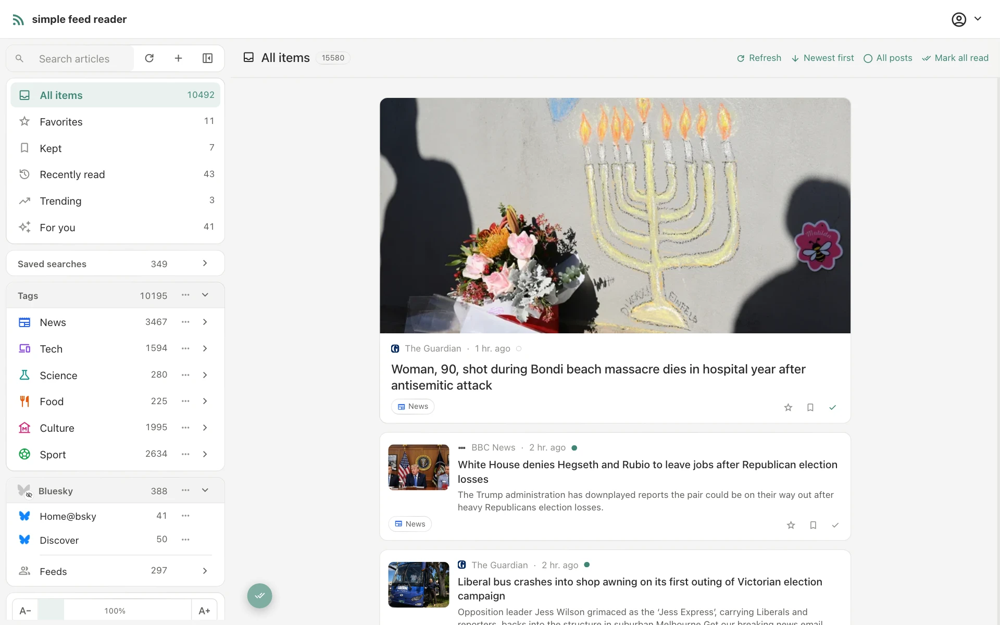
</picture>

Three ways to read: the airy magazine, the two-pane view with the article
beside the list, and the compact list.

<p>
  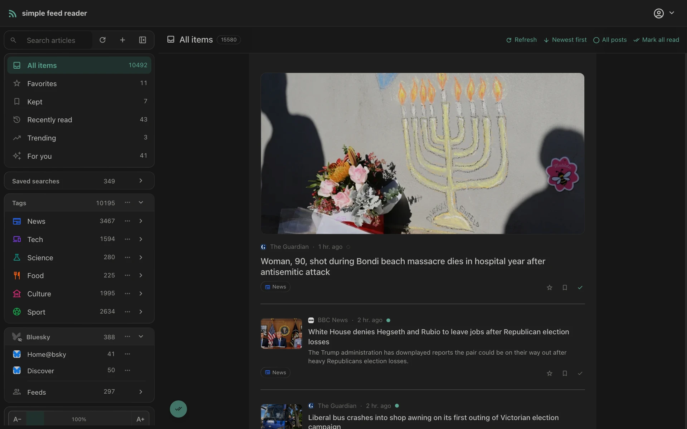
  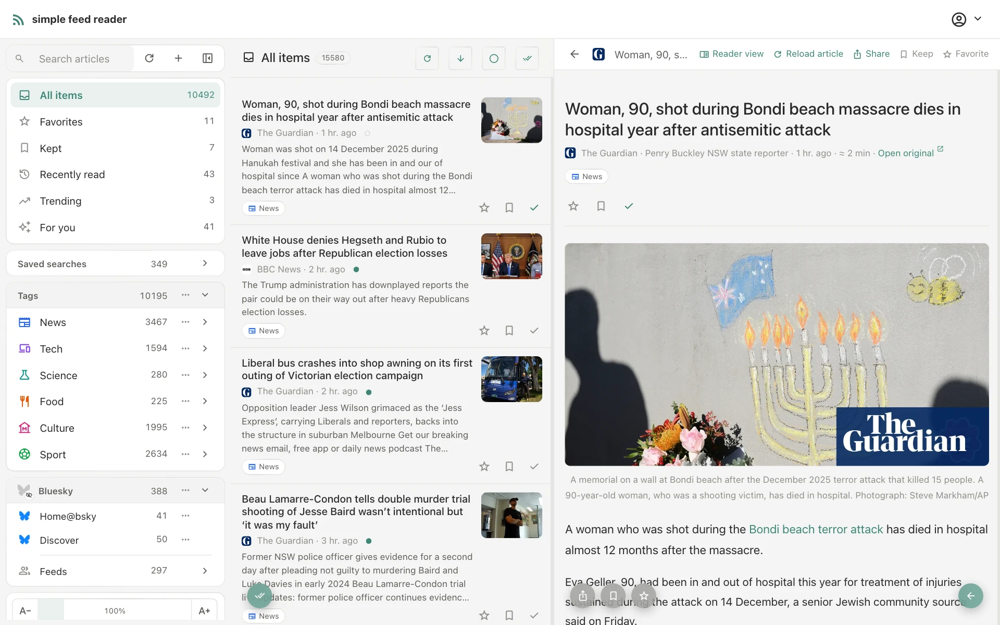
  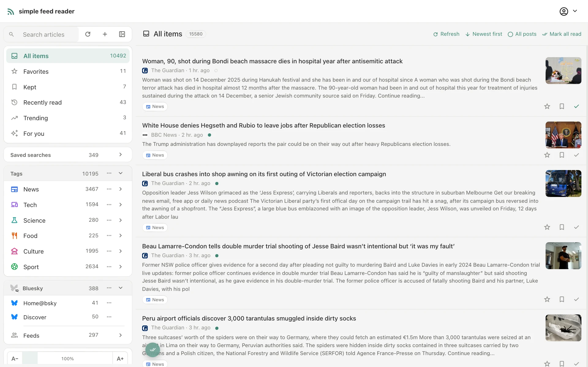
</p>

The same reader on a phone: the magazine, an article, the sidebar drawer, and
"For you".

<p>
  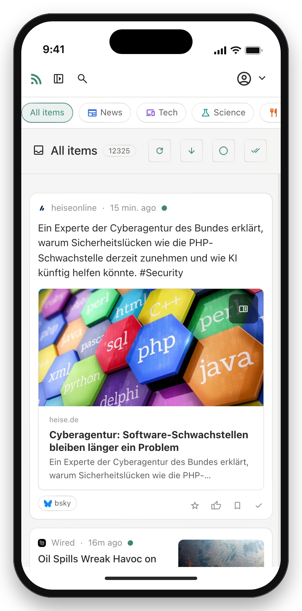
  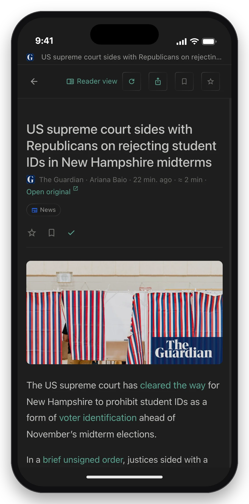
  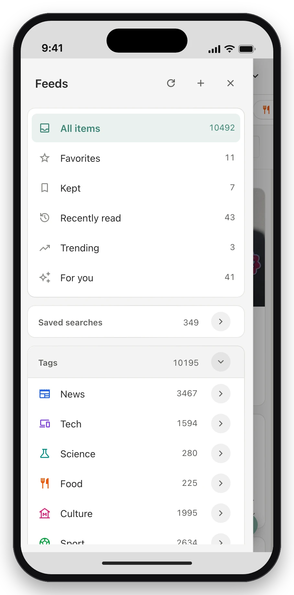
  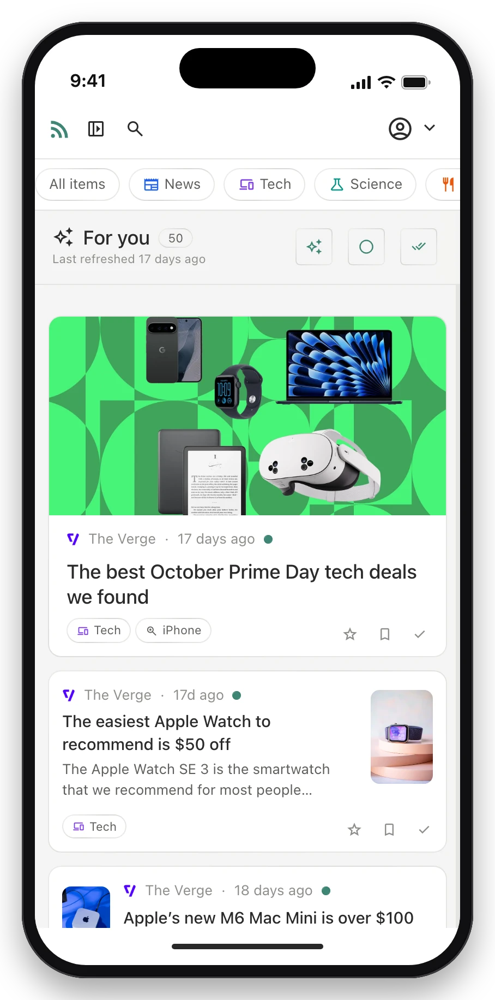
</p>

An AI model of your choice ranks your unread articles into "For you"; a
curated catalog gets a new account started.

<p>
  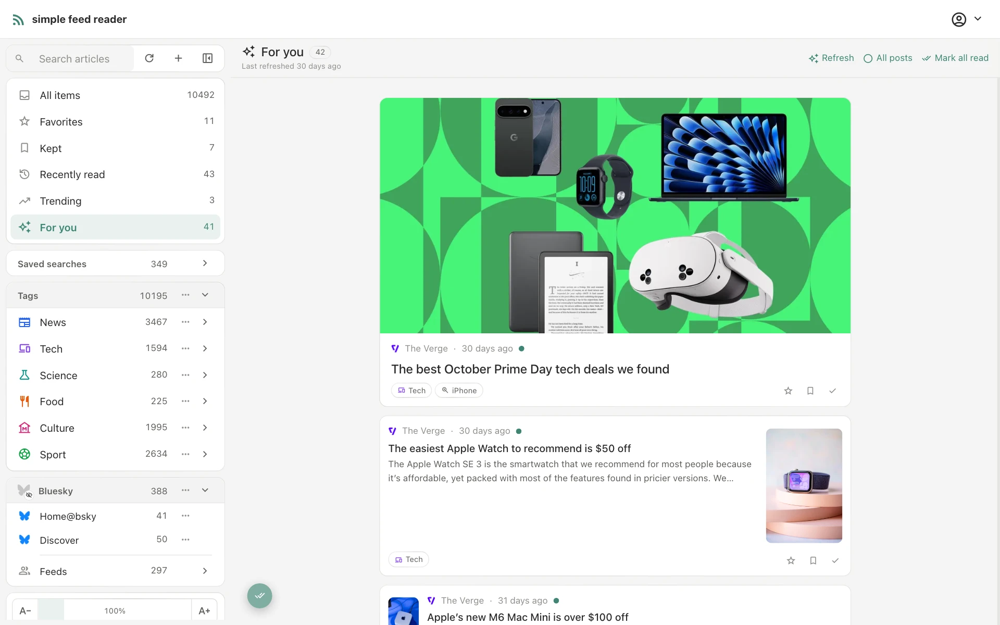
  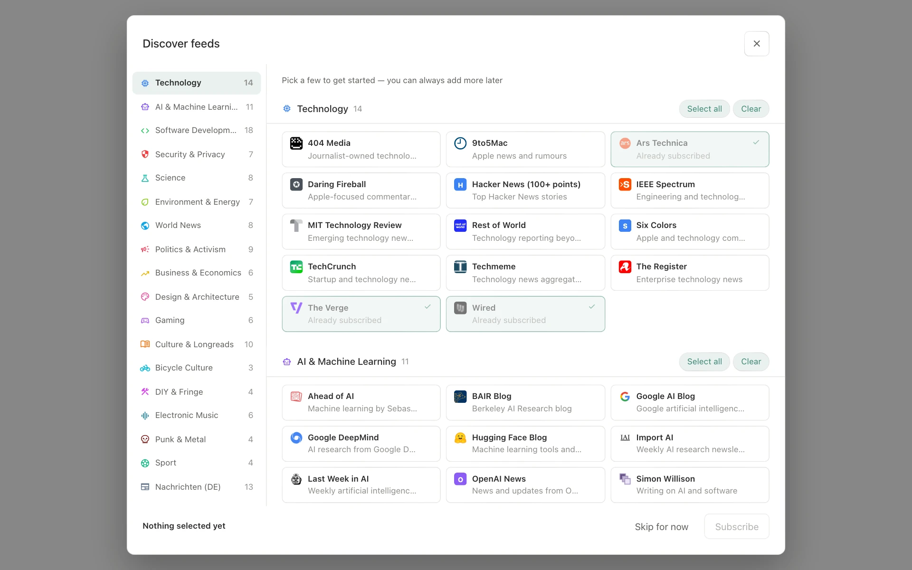
</p>

Podcasts, SoundCloud feeds and Mixcloud shows play in a playlist, seekable like
any episode: episode artwork, previous and next, and a panel to reorder the
queue. A podcast can also be added by pasting its share link from Apple
Podcasts.

<p>
  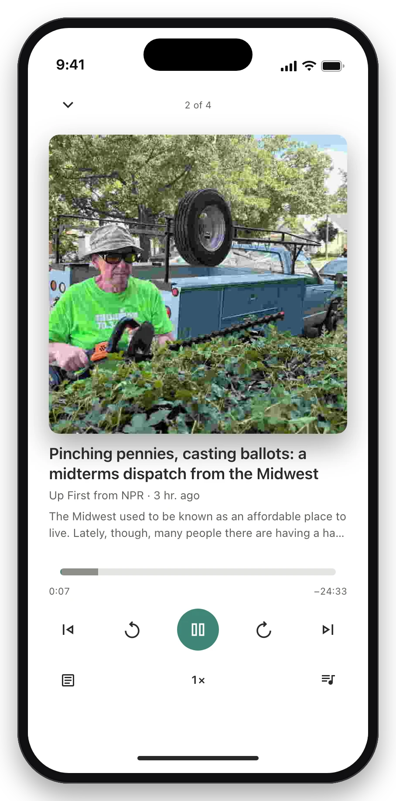
  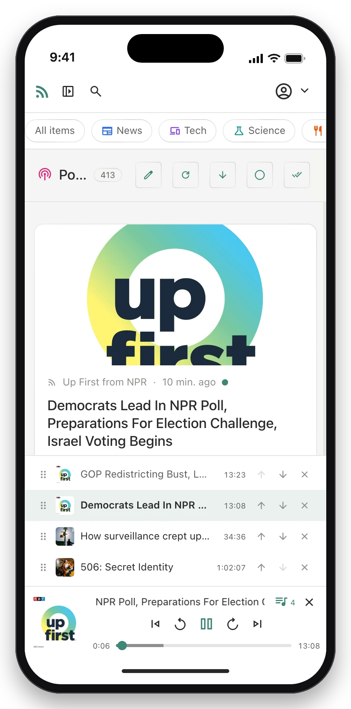
</p>

Connect a Bluesky or Mastodon account and its home timeline, lists, custom
feeds and follows arrive as feeds; a post shows what it embeds, and its likes
and replies stay in the reader.

<p>
  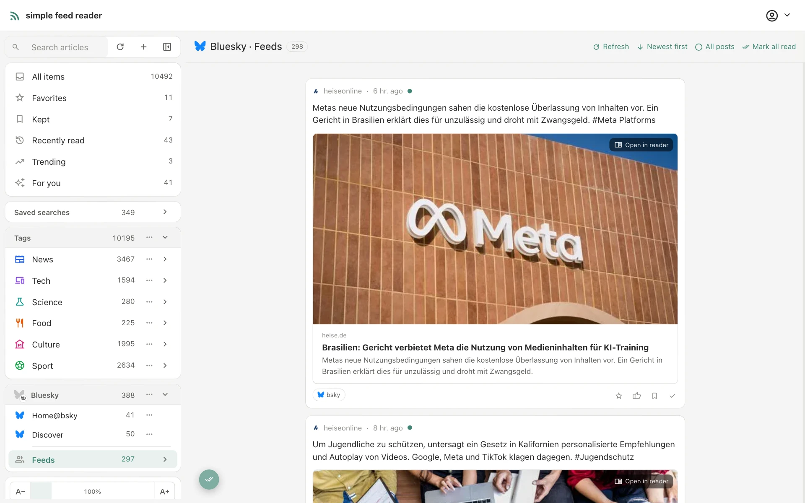
  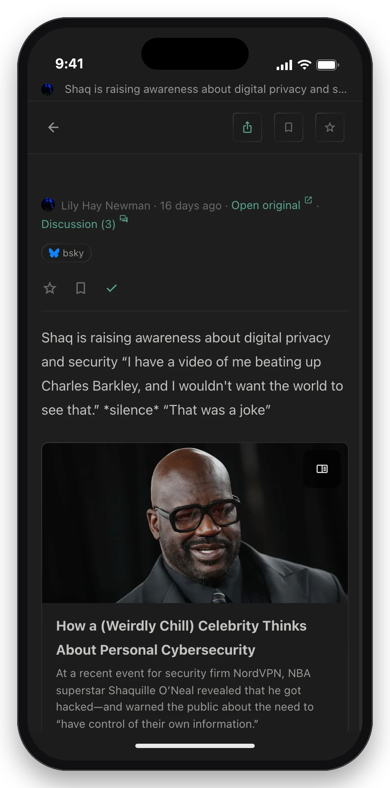
</p>

More in the [screenshot gallery](docs/screenshots.md).


## Features

- **Three layouts** — magazine, compact list, and a two-pane view — with a
  reader view that extracts the full article, images, audio and video inline.
- **Full-text search** with saved searches in the sidebar, each with its own
  unread count, and optional daily or weekly email digests.
- **Podcasts, SoundCloud, Mixcloud and YouTube** — paste a profile, show or
  channel link and subscribe; audio plays in a persistent playlist.
- **Bluesky and Mastodon** — connect an account and its timelines, lists and
  follows arrive as feeds; save a search and its new matches arrive as a feed
  too.
- **Feed discovery** from a website's address, feed previews before you
  subscribe, OPML import and export, tags with colors and icons.
- **Trending** — the stories several of your feeds are covering, from the last
  24 hours or the last 7 days, ranked by how many sources ran them.
- **"For you" (optional)** — an AI model of your choice, local or hosted, ranks
  your unread articles, with a cost overview per run.
- **Accounts** — email and password, Google, Apple or a passkey; several users
  with optional approval, trials and feed limits; full account backup.
- **Mobile first-class** — swipe gestures, pull-to-refresh, light and dark
  themes.
- **Four languages** — English, German, French and Spanish, for the interface
  and the emails.

The full list is in [docs/features.md](docs/features.md).

## Install

You need [Docker](https://docs.docker.com/get-docker/) (running) and
[git](https://git-scm.com/downloads). Then:

```bash
curl -fsSL https://raw.githubusercontent.com/larspohlmann/simple-feed-reader/main/scripts/install.sh | bash
```

Press return at the first question for a personal instance on
`http://localhost:3333`. The packages, TLS, reverse proxies, mail, updates and
backups are in [docs/docker-production.md](docs/docker-production.md); then
[create the first admin](docs/first-run-setup.md).

> **Read before you pipe to bash.** You can inspect exactly what runs at
> [scripts/install.sh](scripts/install.sh). The installer never deletes data.

## Documentation

Everything else — developing, architecture, releasing — is indexed in
[docs/README.md](docs/README.md). [Contributing](CONTRIBUTING.md) ·
[Changelog](CHANGELOG.md) · [MIT license](LICENSE)
